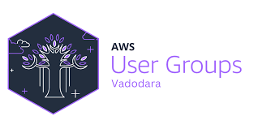

# AWSUG Vadodara - Cloud S3 Filesystem & Drive

A Google Drive-like web interface built specifically for **Amazon S3** buckets, crafted for the AWS User Group Vadodara community.



## Overview

**awsugvad-filesystem** brings a clean, desktop-grade Drive UI directly to your Amazon S3 buckets. All operations execute strictly between your browser and AWS S3 using the official AWS SDK v3 for JavaScript — zero intermediary servers, zero telemetry, and maximum data sovereignty.

---

## Key Features

- **Direct Home S3 Connect**:
  - No marketing clutter: open the homepage and directly enter AWS credentials to connect to your bucket.
  - Active session detection: automatically detects previously saved sessions with 1-click **Open My Drive**.
  - Built-in S3 CORS setup guide with 1-click policy copying and AWS CLI command.
- **Drive File Explorer**:
  - Grid View & List View layouts with sorting.
  - Interactive breadcrumb navigation.
  - Folder creation & path hierarchy.
- **File Operations**:
  - Multi-file & folder upload with drag-and-drop support.
  - Multipart uploads for large files with background queue and progress bars.
  - File download (direct and signed URLs).
  - Folder download as zip.
  - File and folder renaming.
  - Batch and individual file deletion with recovery/confirmation modal.
  - File sharing with customizable expiration presigned URLs.
- **Universal File Previews**:
  - Images (JPEG, PNG, GIF, WebP, SVG) with zoom and pan.
  - Videos (MP4, WebM, MOV).
  - Audio (MP3, WAV, OGG).
  - PDF reader.
  - Code & Text with syntax highlighting.
  - Excel & CSV spreadsheets.
- **Bucket Switcher & Creation**:
  - Quick bucket switching across your AWS account without re-entering credentials.
  - In-app bucket creation and deletion.
- **Advanced Search**:
  - Search across your bucket by filename, extension, file size, or last modified date.
- **Dark, Light & System Themes**:
  - Fully responsive, mobile-friendly interface styled with Tailwind CSS v4 and Google Drive tokens.

---

## Getting Started

### Prerequisites
- Node.js (v18+ or v20+)
- npm or pnpm

### Installation

```bash
# Navigate to the project directory
cd awsugvad-filesystem

# Install dependencies
npm install
```

### Running in Development

```bash
npm run dev
```

Open [http://localhost:3000](http://localhost:3000) in your browser.

### Building for Production

```bash
npm run build
npm start
```

---

## AWS S3 CORS Configuration

Because this client runs in your browser, your S3 bucket must permit CORS requests.

1. Open the [AWS S3 Console](https://s3.console.aws.amazon.com/s3/).
2. Select your bucket -> **Permissions** tab.
3. Scroll down to **Cross-origin resource sharing (CORS)** -> click **Edit**.
4. Paste the following JSON configuration and save:

```json
[
  {
    "AllowedHeaders": ["*"],
    "AllowedMethods": ["GET", "PUT", "POST", "DELETE", "HEAD"],
    "AllowedOrigins": ["*"],
    "ExposeHeaders": [
      "ETag",
      "x-amz-server-side-encryption",
      "x-amz-request-id",
      "x-amz-id-2"
    ],
    "MaxAgeSeconds": 3000
  }
]
```

### Quick AWS CLI Setup

```bash
aws s3api put-bucket-cors --bucket YOUR_BUCKET_NAME --cors-configuration file://cors.json
```

---

## Security

- **Client-Side Only**: Your AWS Access Key ID, Secret Access Key, and session information are kept exclusively in your local browser's `localStorage`.
- **Direct S3 Communication**: Every list, upload, download, and delete request is sent directly to AWS S3 endpoints via HTTPS.
